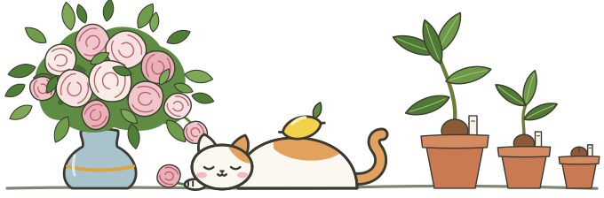

  

# Hitoshi Nakanishi

I write about things I have been thinking about or looking into on my blog, [One More Pot Today](https://hitoshi-nakanishi.github.io/en/). Posts are in Japanese and English.

日々考えたことや調べたことを、ブログ「[One More Pot Today](https://hitoshi-nakanishi.github.io/)」に書いています。記事は日本語と英語で書いています。

## Projects

| Project | What it does |
| :--- | :--- |
| [Lethe](https://github.com/Hitoshi-Nakanishi/lethe-app) | A desktop app that transcribes meetings and calls locally with Whisper and writes Markdown minutes |
| [Theia](https://github.com/Hitoshi-Nakanishi/theia) | A desktop app that pulls the same cells out of many Excel workbooks into one table, without opening Excel |
| [Ares](https://github.com/Hitoshi-Nakanishi/ares) | Starts and stops local GPU inference engines while watching memory, so that a large model does not freeze the machine |

## Links

[Blog](https://hitoshi-nakanishi.github.io/en/) · [About](https://hitoshi-nakanishi.github.io/en/about/) · [LinkedIn](https://www.linkedin.com/in/x37/) · [RSS](https://hitoshi-nakanishi.github.io/en/rss.xml)
